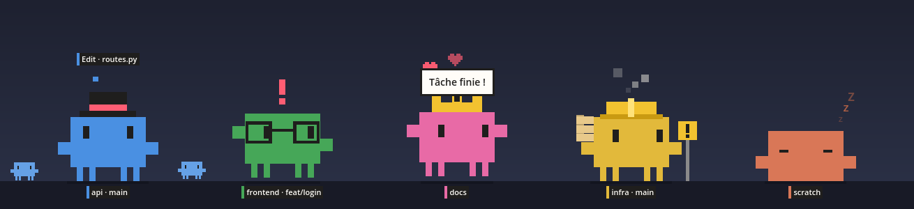
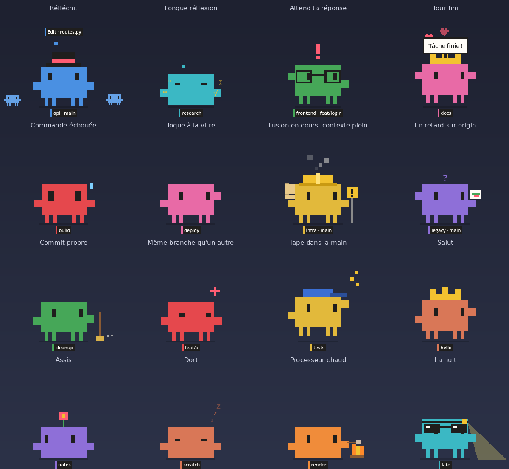
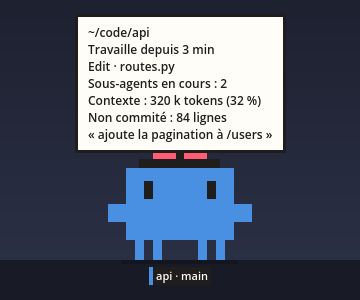
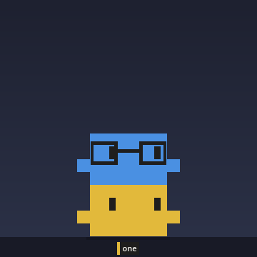
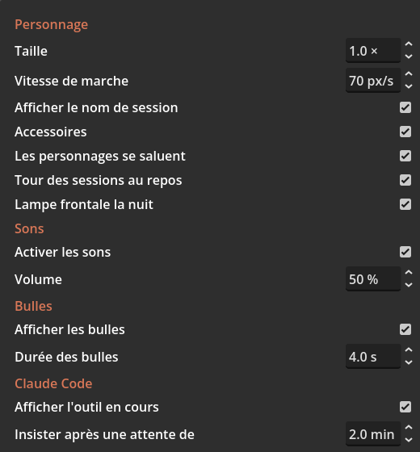
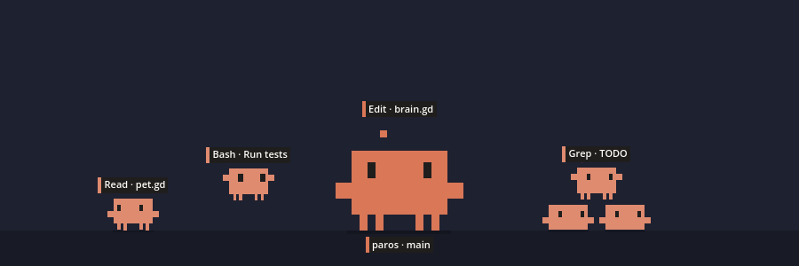
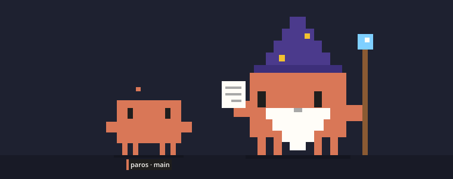

# Paros

[English](README.md) · **Français**

Compagnon de bureau pour Claude Code et agy (Google Antigravity : la CLI agy et Antigravity Desktop). Un petit personnage en pixels vit au bas de l'écran, un par session ouverte. Un coup d'œil suffit pour savoir ce que fait chaque session : elle travaille, elle attend une réponse, elle a fini.

Compatible avec [Diaulos](https://github.com/Dr1mS/Diaulos), le pont entre sessions agy et Claude Code : les messages qu'elles s'envoient volent d'un personnage à l'autre sous forme de lettres.



Godot 4.7, GDScript. Aucun fichier image ni son : tout est dessiné et synthétisé par le code.

> Paros est un projet de fan non officiel. Il n'est ni affilié à Anthropic ou Google ni approuvé par eux.

## Ce qu'il fait

- **Un personnage par session.** Il porte le nom de la session (`/rename`) et la branche git sous ses pieds, prend la couleur de la session (`/color`) et a son propre accessoire.
- **Il montre l'état de la session.** Il réfléchit quand Claude travaille, avec l'outil en cours au-dessus de la tête. Il agite les bras quand Claude attend une permission ou une réponse. Il saute quand le tour est fini.
- **Il réagit à votre travail.** Tests verts ou rouges, commandes échouées, contexte plein, modifications non commitées, fusion en cours, commit propre.
- **Chaque sous-agent a son petit personnage.** Il reste près du grand, affiche son outil en cours, et joue comme un enfant : il saute, court vers les autres, monte des pyramides avec eux. Seize au plus par session.
- **Il se vide la tête quand le contexte est compacté.** Assis près d'une corbeille, il sort des feuilles de sa tête, les froisse et les y jette, puis secoue la tête, plus léger.
- **Les sessions agy ont aussi leur personnage.** Il est dessiné d'après la mascotte d'agy, un « A » en dégradé, et vit avec les personnages Claude. Il réfléchit, montre son outil, fait signe quand agy vous pose une question, a des petits personnages pour ses sous-agents, attend ses commandes en arrière-plan, saute de joie en fin de tour, et écrit des lettres par Diaulos. Les sessions de la CLI agy et les conversations d'Antigravity Desktop, tant que la fenêtre les affiche ou qu'elles travaillent, en ont toutes un. Voir [agy](docs/fr/agy.md).
- **Le sage vient quand la session consulte l'advisor.** Chapeau pointu, barbe blanche et bâton : il lit la lettre que le personnage lui lance, répond, puis sort de l'écran.
- **Il vit sur le bureau.** Il traverse les écrans, s'assoit, dort la nuit, salue les autres personnages, se laisse lancer, grimpe sur la fenêtre active.
- **Il ne gêne pas.** Un clic à côté de lui le traverse. Il quitte l'écran d'une application en plein écran.



| Fiche au survol | Les sessions au repos s'empilent | Réglages |
|---|---|---|
|  |  |  |

| Sous-agents | Advisor |
|---|---|
|  |  |

| Sessions agy, à côté de Claude Code |
|---|
|  |

L'interface (bulles, menu, réglages) est en français ou en anglais. Elle suit la langue du système, et se règle dans les réglages.

## Musique

Quand un lecteur joue de la musique, les personnages bougent un peu : ils hochent la tête en rythme, penchent d'un côté puis de l'autre, et une petite note monte à côté de leur tête. Seulement debout, assis ou en réflexion : l'état de la session reste lisible.

Paros interroge les lecteurs par MPRIS, que parlent Spotify, VLC et les navigateurs. Sous Linux, il faut `gdbus`, présent sur la plupart des bureaux. Sous Windows, Paros interroge les sessions média du système (Spotify, navigateurs, VLC…). Une vidéo en lecture dans un navigateur compte comme de la musique. Pour couper : « Réglages… », décocher « Bouger en musique ».

## Démarrage rapide

```sh
git clone https://github.com/Dr1mS/Paros.git
cd Paros
export GODOT_PATH=/chemin/vers/godot    # Godot 4.7 ou plus récent
./run.sh
```

Pour quitter : clic droit sur un personnage, puis « Quitter ».

Trois étapes facultatives complètent l'installation :

1. **Hooks Claude Code**, pour les bulles et les réactions aux outils : voir [Claude Code](docs/fr/claude-code.md#installer-les-hooks).
2. **Extension GNOME Shell**, pour le focus du terminal, le perchoir, l'écran de verrouillage et le plein écran : `./gnome-extension/install.sh`, puis se déconnecter et se reconnecter. Voir [Extension GNOME](docs/fr/extension-gnome.md).
3. **Lancement à l'ouverture de session** : « Réglages… », cocher « Lancer au démarrage ».

Sans elles, les personnages suivent quand même les sessions, leur nom, leur couleur et leur état.

Les sessions agy ne demandent rien de plus : Paros trouve seul celles de la CLI agy et d'Antigravity Desktop, sous Linux. Les personnages Desktop se désactivent dans les réglages. Un hook facultatif signale la fin d'un tour annulé : voir [agy](docs/fr/agy.md#le-hook).

Sous Linux, pour voir le sage pendant que l'advisor travaille, il faut `python3-gi` (présent avec GNOME) : Paros lit alors le texte visible des terminaux. Voir [Advisor](docs/fr/claude-code.md#advisor) et [Confidentialité](docs/fr/claude-code.md#confidentialité).

Pour lancer sans Godot, construire un binaire autonome avec `./build.sh` (voir [Développement](docs/fr/developpement.md#exporter-en-binaire)).

## Gestes

| Geste | Effet |
|---|---|
| Clic | Le personnage saute de joie |
| Double-clic | Met le terminal de sa session au premier plan |
| Glisser | Le porter. Lâché avec élan, il vole et rebondit |
| Survol | Fiche de la session |
| Déposer un fichier dessus | Copie le chemin dans le presse-papiers |
| Clic droit | Menu : terminal, minuteur de focus, réglages, quitter |

## Documentation

| Guide | Contenu |
|---|---|
| [Utilisation](docs/fr/utilisation.md) | Tous les comportements, les gestes, le menu, les réglages |
| [Claude Code](docs/fr/claude-code.md) | Ce que Paros lit des sessions, sous-agents, advisor, installation des hooks, confidentialité |
| [agy](docs/fr/agy.md) | Sessions de la CLI agy et conversations d'Antigravity Desktop, lettres par Diaulos, hook facultatif, limites |
| [Extension GNOME](docs/fr/extension-gnome.md) | Focus du terminal, perchoir, écran de verrouillage, plein écran |
| [Architecture](docs/fr/architecture.md) | Organisation du code, référence des événements, comment ajouter un sens ou un comportement |
| [Développement](docs/fr/developpement.md) | Tests, export en binaire, performances, limites connues, dépannage |

## Plateformes

| | État |
|---|---|
| Linux, GNOME, Wayland | Testé |
| Linux, autre bureau | Le cœur fonctionne. Les parties propres à GNOME restent muettes |
| agy | Linux seulement, la CLI agy et Antigravity Desktop. Testé avec agy (serveur de langage 1.4) |
| Windows | Testé depuis les sources (Godot 4.7, Git Bash pour les hooks, `./test.ps1` pour les tests). Un script PowerShell (`windows/`) remplace l'extension GNOME : focus du terminal, perchoir, plein écran, inactivité, musique, batterie. Pas de personnages sur l'écran de verrouillage, pas d'alerte de température. Le sage vient une fois la réponse de l'advisor arrivée, pas pendant l'appel |

## Tests

```sh
./test.sh
```

135 tests unitaires, sans affichage, en quelques secondes.

## Licence

[MIT](LICENSE). La licence couvre le code de ce dépôt. Les personnages dessinés par Paros reprennent la mascotte de Claude Code, qui appartient à Anthropic, et celle d'agy, qui appartient à Google.
